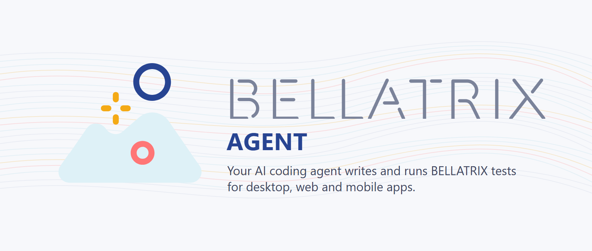

<!-- Banner -->
<p align="center">
  
</p>

<!-- Badges -->
<p align="center">
  <a href="https://www.nuget.org/packages/Bellatrix.Cli"></a>
  <a href="https://github.com/AutomateThePlanet/BELLATRIX-AI-Agents/actions/workflows/ci.yml"></a>
  <a href="LICENSE"></a>
  <a href="https://dotnet.microsoft.com/download"></a>
  <a href="https://bellatrix.solutions/agent/"></a>
</p>

<p align="center">
  📖 <strong>Browse the full documentation at <a href="https://bellatrix.solutions/agent/">bellatrix.solutions/agent</a></strong>
</p>

<!-- Tagline -->
<p align="center">
  <strong>The agentic test automation framework.</strong><br>
  Your AI coding agent writes and runs BELLATRIX tests for desktop, web and mobile apps.
</p>

---

## What it is

BELLATRIX Agent lets your AI coding agent (Claude Code, GitHub Copilot, Cursor, Devin, Codex CLI, Gemini CLI,
Antigravity CLI, Kiro CLI or OpenCode) automate test cases with the [BELLATRIX](https://bellatrix.solutions)
framework in C#, Java or TypeScript. It has two parts:

- **`bellatrix`**, a .NET global tool that drives desktop (WinAppDriver), web (Selenium) and mobile (Appium, Android
  and iOS) apps one shell command at a time. It runs no AI model and holds no credentials: your agent does the
  thinking, the CLI does the driving, and every command prints one line of JSON.
- **`bellatrix init`**, which writes skills, subagents and an instruction file into your test repository, in your
  agent's native layout. They teach the agent the BELLATRIX components, page objects and test structure, and how to
  find stable locators without reading whole UI trees into its context.

## Quick start

**Prerequisites:** [.NET 8.0+](https://dotnet.microsoft.com/download), and for the domain you automate: WinAppDriver
(desktop), Chrome/Edge/Firefox (web) or Appium 2 with a device (mobile).

```bash
# Install the CLI
dotnet tool install -g Bellatrix.Cli

# In the root of your test repository: scaffold the skills and subagents for your agent
bellatrix init --agent claude --language csharp --domains desktop
```

Then open the repository in your agent and ask:

> "Automate TC-1006"

The agent reads the test case, runs it step by step through `bellatrix`, resolves the locators, and writes the page
objects and the test in your project's BELLATRIX style. Use `--agent copilot`, `cursor`, `devin`, `codex`, `gemini`,
`antigravity`, `kiro` or `opencode` for other agents, `--language java|typescript`, and `--domains desktop,web,mobile`.

`init` records your test project in `.bellatrix/config.json` (commit it):

```json
{
  "$schema": "https://raw.githubusercontent.com/AutomateThePlanet/BELLATRIX-AI-Agents/v3.2.0/schemas/bellatrix-config.v1.schema.json",
  "version": 1,
  "testCasesDir": "test-cases"
}
```

Offline or pinned install from the GitHub release `.nupkg`: [docs/INSTALL-PREVIEW.md](docs/INSTALL-PREVIEW.md).
Every command and flag: `bellatrix help`, or the [CLI reference](https://bellatrix.solutions/agent/).

## Supported agents

What `bellatrix init --agent <name>` writes for each of the nine supported agents:

<!-- provider-matrix:begin -->
<!-- generated from docs/support-matrix.json by scripts/gen-readme-matrix.ps1; do not edit by hand -->
| Agent | `--agent` | Instructions | Skills | Subagents (locator specialist + generator) |
|---|---|---|---|---|
| **Claude Code** | `claude` | `.bellatrix/bellatrix.instructions.md` + one `@import` line in `CLAUDE.md` | `.claude/skills/` | `.claude/agents/*.md` |
| **GitHub Copilot** | `copilot` | `.github/instructions/bellatrix.instructions.md` (`applyTo: "**"`) | `.github/skills/` (or reuses `.claude/skills/`) | `.github/agents/*.agent.md`, with `agents:` allow-list on generators. Reuses `.claude/agents/` when Claude is scaffolded |
| **Cursor** | `cursor` | `.cursor/rules/bellatrix.mdc` (`alwaysApply: true`) | `.cursor/skills/` (or reuses `.claude/skills/`) | `.cursor/agents/*.md` (`readonly: true` on specialists) |
| **Devin Desktop** (formerly Windsurf) | `devin` | `.devin/rules/bellatrix.md` (`trigger: always_on`) | `.devin/skills/` (or reuses `.claude/skills/`) | `.devin/agents/*.md` (`allowed-tools`) |
| **Codex CLI** | `codex` | One marker block in `AGENTS.md` pointing at `.bellatrix/bellatrix.instructions.md` | `.agents/skills/` | `.codex/agents/*.toml` |
| **Gemini CLI** (enterprise) | `gemini` | One marker block in `GEMINI.md` importing `@./.bellatrix/bellatrix.instructions.md` | `.agents/skills/` | `.gemini/agents/*.md` (`kind: local`, Gemini tool names) |
| **Antigravity CLI** (agy) | `antigravity` | `.agents/rules/bellatrix.md` (`trigger: always_on`) | `.agents/skills/` | `.agents/agents/<name>/agent.md` (documented tool names; `mainAgent`/`subagent`) |
| **Kiro CLI** | `kiro` | `.kiro/steering/bellatrix.md` (`inclusion: always`) | `.kiro/skills/` | `.kiro/agents/*.md` (v3 Markdown; `resources` list the steering file and skills) |
| **OpenCode** | `opencode` | One marker block in `AGENTS.md` pointing at `.bellatrix/bellatrix.instructions.md` (shared with Codex) | `.opencode/skills/` (or reuses `.claude/skills/` / `.agents/skills/`) | `.opencode/agents/*.md` (`mode: subagent`, `edit: deny` on specialists) |
<!-- provider-matrix:end -->

Your own `CLAUDE.md`, `AGENTS.md` and `GEMINI.md` keep their content (BELLATRIX adds one line or one marked block),
and a file you edit is never overwritten on a re-run unless you pass `--regenerate`.

## Supported languages and platforms

Every supported agent gets the same skills for each language and platform below.

<!-- support-matrix:begin -->
<!-- generated from docs/support-matrix.json by scripts/gen-readme-matrix.ps1; do not edit by hand -->
| Language | Desktop | Web | Mobile (Android + iOS) |
|---|---|---|---|
| C# | ✓ | ✓ | ✓ |
| Java | ✓ | ✓ | ✓ |
| TypeScript | — | ✓ | — |

TypeScript: web only (the BELLATRIX TypeScript framework has no desktop or mobile component layer).
<!-- support-matrix:end -->

## Ecosystem

BELLATRIX Agent is part of the [Automate The Planet](https://www.automatetheplanet.com/) ecosystem:

| Tool | Purpose |
|------|---------|
| [BELLATRIX](https://github.com/AutomateThePlanet/BELLATRIX) | Test automation framework (also [Java](https://github.com/AutomateThePlanet/BELLATRIX-Java) and [TypeScript](https://github.com/AutomateThePlanet/BELLATRIX-JavaScript)) |
| [SPECTRA](https://github.com/AutomateThePlanet/Spectra) | AI test case generation and execution; the `*-spectra-test` skills automate SPECTRA test cases with traceability |
| [Testimize](https://github.com/AutomateThePlanet/Testimize) | Test case optimization (boundary values, pairwise, ABC) |
| **BELLATRIX Agent** | Your AI coding agent writes and runs BELLATRIX tests |

## Learn more

- [bellatrix.solutions](https://bellatrix.solutions/) and the [BELLATRIX Agent guide](https://bellatrix.solutions/agent/)
- [BELLATRIX on Automate The Planet](https://www.automatetheplanet.com/bellatrix/)
- [Introducing BELLATRIX Agent](https://www.automatetheplanet.com/introducing-bellatrix-agent/) — the launch post
- [CHANGELOG.md](CHANGELOG.md)

## Contributing

Contributions are welcome! See [CONTRIBUTING.md](CONTRIBUTING.md) for building, testing, golden files and how to add
an agent or a language. Please read the [Code of Conduct](CODE_OF_CONDUCT.md); report security issues as described in
[SECURITY.md](SECURITY.md).

## License

Licensed under the **Apache License, Version 2.0**. See [LICENSE](LICENSE) for the full text.
Copyright 2026 Automate The Planet Ltd.
